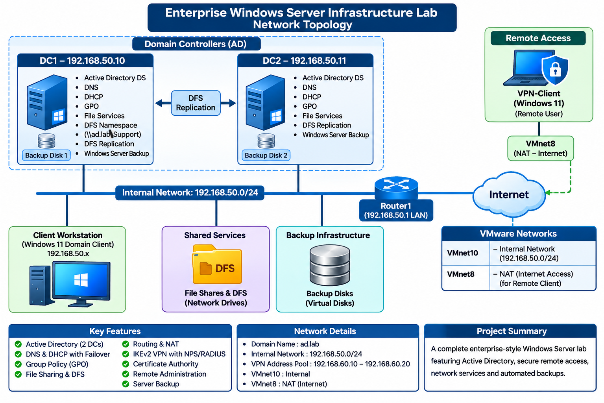
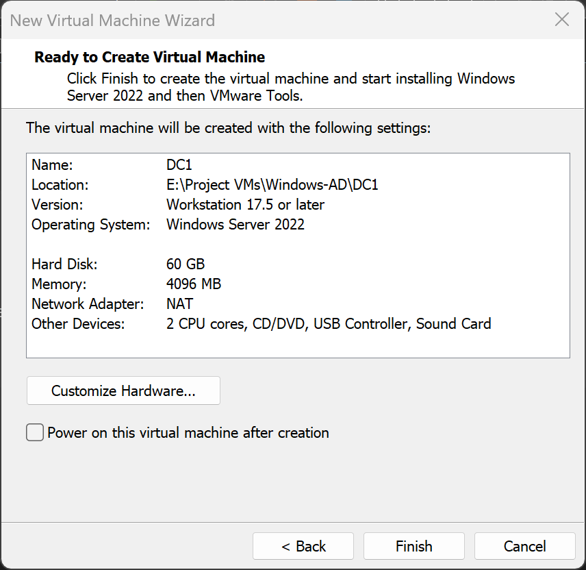
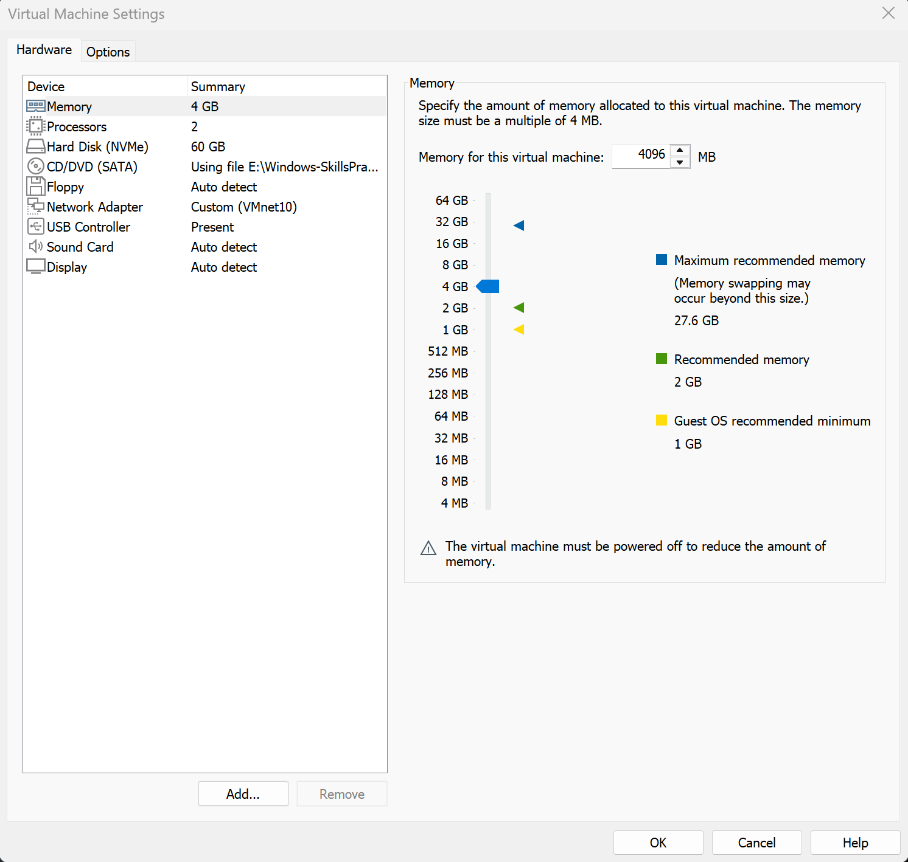
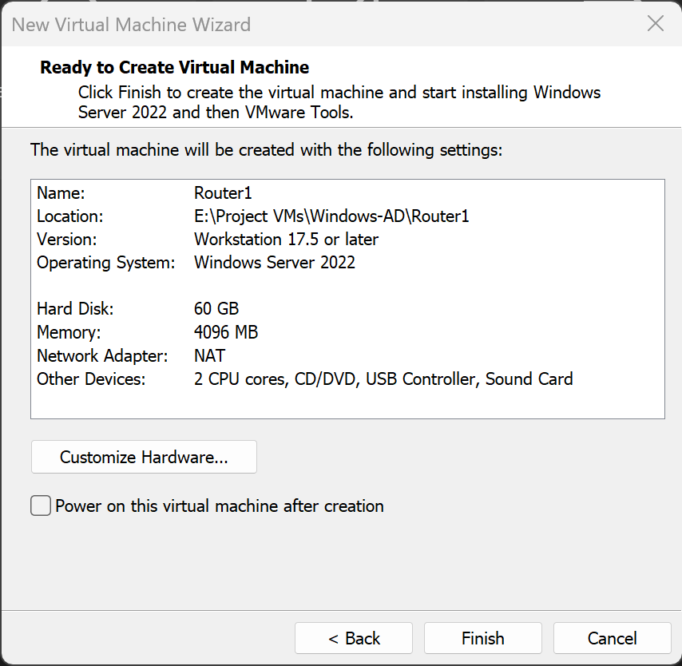
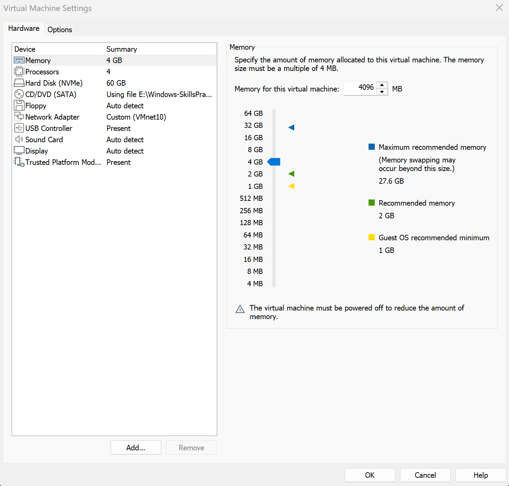
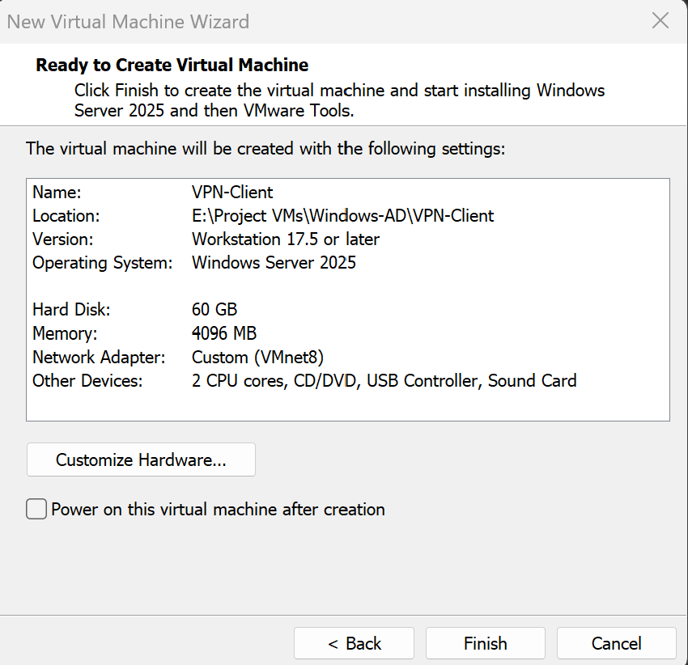

# Enterprise Windows Server Infrastructure Lab

## 1. Project Overview

This project demonstrates the design, deployment, configuration, and administration of an enterprise-style Windows Server infrastructure in a virtualized home lab using VMware Workstation.

The environment consists of two Windows Server 2022 domain controllers, a routing and remote access server, and Windows 11 client virtual machines.

The lab was designed to practice core infrastructure administration, including centralized identity management, network services, Group Policy, file sharing, distributed file systems, secure remote access, and server backup.

The project also demonstrates how multiple infrastructure services work together to provide centralized management, network connectivity, and remote administration.

All configurations and testing were performed in an isolated virtual lab environment for educational and portfolio purposes.

## 2. Lab Architecture and Network Topology

The lab was built using VMware Workstation with an isolated internal network and a separate NAT network for external connectivity.

The internal network uses the `192.168.50.0/24` subnet. Domain controllers and internal clients communicate through this network, with Router1 providing routing and NAT services.

### 2.1 Network Configuration

| Network Component | Configuration |
|---|---|
| Internal Network | VMnet10 |
| Internal Subnet | 192.168.50.0/24 |
| External/NAT Network | VMnet8 |
| Router1 LAN Address | 192.168.50.1 |
| Router1 WAN Address | DHCP |
| DC1 Address | 192.168.50.10 |
| DC2 Address | 192.168.50.11 |
| DHCP Address Pool | 192.168.50.100–192.168.50.200 |
| VPN Address Pool | 192.168.60.10–192.168.60.20 |
| Active Directory Domain | ad.lab |

### 2.2 Virtual Machines

| Virtual Machine | Operating System | Purpose |
|---|---|---|
| DC1 | Windows Server 2022 | Primary domain controller, DNS, DHCP, Group Policy, file services, DFS, AD CS, NPS and Windows Server Backup |
| DC2 | Windows Server 2022 | Additional domain controller, DNS, DHCP, Group Policy, file services, DFS, NPS and Windows Server Backup |
| Router1 | Windows Server 2022 | Routing, NAT, RRAS and IKEv2 VPN |
| Client-PC | Windows 11 Pro | Internal domain client and policy testing |
| VPN-Client | Windows 11 Pro | Remote VPN connectivity and administration testing |

### 2.3 Network Topology

The following diagram illustrates the virtual infrastructure, internal network, routing configuration, domain controllers, and remote VPN connectivity.

### 2.4 Network Design

- **VMnet10:** Provides internal connectivity between the domain controllers, Router1, and internal client.
- **VMnet8:** Provides NAT connectivity for Router1's WAN interface and the VPN client.
- **Router1:** Connects the internal network to external connectivity through RRAS and NAT.
- **DC1 and DC2:** Provide redundant domain controller and network services.
- **VPN-Client:** Connects remotely to Router1 using IKEv2 VPN and accesses internal resources.

## 3. VMware Virtual Infrastructure

### 3.1 Virtual Machine Deployment

VMware Workstation was used to create and manage five virtual machines for the Windows Server infrastructure lab.

Each virtual machine was configured with the necessary virtual hardware resources and network adapter settings based on its intended role in the lab.

The following virtual machines were deployed:

| Virtual Machine | Operating System | Purpose |
|---|---|---|
| DC1 | Windows Server 2022 | Primary domain controller |
| DC2 | Windows Server 2022 | Additional domain controller |
| Router1 | Windows Server 2022 | Routing, NAT and VPN services |
| Client-PC | Windows 11 Pro | Internal workstation and Group Policy testing |
| VPN-Client | Windows 11 Pro | Remote VPN connectivity and administration testing |

### 3.2 Virtual Machine Hardware Configuration

The following screenshots show the basic virtual machine configurations in VMware Workstation, including the virtual hardware settings for each system.

#### DC1

#### DC2

#### Router1

#### Client-PC

#### VPN-Client

### 3.3 Virtual Network Design

Two VMware virtual networks were used to separate internal lab communication from external network connectivity.

- **VMnet10:** Internal virtual network used for communication between the domain controllers, Router1 and the internal workstation.
- **VMnet8:** VMware NAT network used for Router1's WAN connectivity and the remote VPN client.

Router1 was configured with two virtual network adapters:
- LAN adapter connected to VMnet10.
- WAN adapter connected to VMnet8.

This network design allowed Router1 to provide routing and NAT services between the internal lab network and external connectivity.
